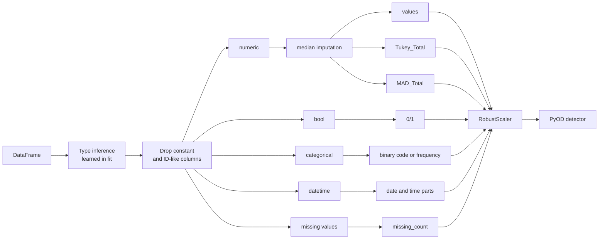

# AutoAD - automatic preprocessing for anomaly detection on tabular data

AutoAD turns a mixed-type pandas DataFrame into a numeric feature matrix and, if you
want, fits a [PyOD](https://github.com/yzhao062/pyod) detector on it. On the way it

- learns a type for every column (numeric, bool, datetime, categorical) and applies
  exactly the same casting to new data,
- adds robust univariate outlier counts per row (Tukey's fences and the modified
  z-score) as features,
- marks missing values instead of silently imputing them away,
- drops constant and ID-like columns, and scales everything before the detector.

Every decision is stored on the fitted object, so you can check what happened.

> **Status:** 0.x - the API may still change. See the [changelog](CHANGELOG.md).

## Installation

```bash
pip install "git+https://github.com/JAdelhelm/AutoAD.git"
```

For development:

```bash
git clone https://github.com/JAdelhelm/AutoAD.git
cd AutoAD
pip install -e ".[dev]"
pytest
```

The distribution name is `autoad-framework` (the name `autoad` on PyPI belongs to an
unrelated project); the import name is `autoad`. The unrelated package uses the same
import name, so do not install both in one environment. Python 3.11 or newer is required.

## Quick start

```python
import pandas as pd
from pyod.models.iforest import IForest

from autoad import AutoAD

X_train = pd.read_csv("examples/X_train.csv")
X_test = pd.read_csv("examples/X_test.csv")

ad = AutoAD(detector=IForest(random_state=0)).fit(X_train)

report = ad.report(X_test)            # X_test plus anomaly information
report.sort_values("AD_score", ascending=False).head()

scores = ad.decision_function(X_test)  # higher = more anomalous
labels = ad.predict(X_test)            # 0/1, based on the detector's contamination
features = ad.transform(X_test)        # the scaled matrix the detector sees
```

More examples, with synthetic data, are in [`examples/examples.ipynb`](examples/examples.ipynb)
(`pip install -e ".[examples]"`). [`examples/main.py`](examples/main.py) is a minimal script.

## Output

### `report(X)`

A copy of `X` (rows in their original order) with these columns added:

| Column | Meaning |
| --- | --- |
| `AD_score` | Score of the detector, higher means more anomalous. Only if a detector was given. |
| `Tukey_Total` | Number of the row's numeric values outside Tukey's fences (`Q1 - 1.5·IQR`, `Q3 + 1.5·IQR`). |
| `MAD_Total` | Number of the row's numeric values with a modified z-score above 3.5. |
| `Tukey_Columns`, `MAD_Columns` | Names of those columns, comma separated. |

### `transform(X)`

The scaled feature matrix. Feature names (see `get_feature_names_out()`):

| Column type | Features |
| --- | --- |
| numeric | the value itself, plus `Tukey_Total` and `MAD_Total` for the row |
| bool | 0/1 |
| categorical, at most 20 distinct values | binary code `<name>_0`, `<name>_1`, ... ([BinaryEncoder](https://contrib.scikit-learn.org/category_encoders/binary.html)) |
| categorical, more distinct values | `<name>_FREQ`: share of the category in the training data, 0 for unseen categories |
| datetime | `<name>_YEAR`, `_MONTH`, `_DAY`, `_WKDAY`, plus `_HOUR`, `_MINUTE`, `_SECOND` if the column contains a time of day |
| all columns | `missing_count`: number of missing values in the row, counted before imputation |

### Attributes after `fit`

| Attribute | Content |
| --- | --- |
| `column_types_` | type learned for every column |
| `dropped_columns_` | dropped columns and the reason (`"constant"` or `"id"`) |
| `column_groups_` | columns per feature group |
| `feature_importances` | importance per feature, for detectors with `feature_importances_` such as `IForest` |
| `preprocessor_`, `detector_` | the fitted scikit-learn pipeline and detector |

## Parameters

| Parameter | Default | Description |
| --- | --- | --- |
| `detector` | `None` | Unfitted PyOD detector. Without one, AutoAD only builds the feature matrix. |
| `datetime_columns` | `None` | Columns to parse as dates. Other text columns become dates only if at least 95 % of their values are dates. |
| `numerical_columns` | `None` | Columns to treat as numbers although they are stored as text. |
| `exclude_columns` | `None` | Columns to ignore. They may be missing in later inputs. |
| `drop_constant` | `True` | Drop columns with a single distinct value (missing counts as a value). |
| `drop_id_columns` | `True` | Drop ID-like columns: unique, complete values with a name such as `id`/`customer_id`, or unnamed integer columns with consecutive values (from 20 rows on). |
| `max_binary_categories` | `20` | Categorical columns with more distinct values are frequency-encoded. |
| `tukey_factor` | `1.5` | IQR multiple for Tukey's fences. |
| `mad_threshold` | `3.5` | Threshold for the modified z-score. |
| `missing_indicator` | `"count"` | `"count"`: one `missing_count` column; `"columns"`: one `<name>_MISSING` column per input column; `None`: no marker. |
| `scaler` | `"robust"` | `"robust"`, `"standard"`, `"minmax"`, `None` (no scaling) or any scikit-learn transformer. |
| `n_jobs` | `1` | Parallel jobs for the column transformer. |

`AutoAD` is a scikit-learn estimator: `get_params`, `set_params` and `clone` work, and
`fit` returns the estimator itself.

## How it works



**Types** are learned once during `fit`. Text columns become numeric if all values are
numbers (`"2001"` stays a number), datetime only if almost all values contain digits and
parse as dates, otherwise categorical. Placeholders such as `""`, `"nan"` or `"None"`
count as missing. During `transform` every column is cast to its learned type; values
that do not fit become missing.

**Tukey and MAD** are computed per column on the imputed training data. If the IQR of a
column is 0, Tukey falls back to the 5 %/95 % quantiles (and skips the column if those
are equal too). If the MAD is 0, the modified z-score uses the mean absolute deviation
(`M = (x - median) / (1.253314 · MeanAD)`).

**Binary encoding** of nominal columns needs far fewer dimensions than one-hot encoding
and performed comparably in these studies:

- John T. Hancock and Taghi M. Khoshgoftaar. "Survey on categorical data for neural
  networks." Journal of Big Data 7.1 (2020), pp. 1-41, tables 2 and 4.
- Diogo Seca and João Mendes-Moreira. "Benchmark of Encoders of Nominal Features for
  Regression." World Conference on Information Systems and Technologies, 2021,
  pp. 146-155, p. 151.

The original design diagram is in [`docs/img/decision_rules.png`](docs/img/decision_rules.png).

## Limitations

- Tukey and MAD look at one numeric column at a time. Unusual combinations of normal
  values are left to the detector.
- The detector decides the quality of `AD_score`. There is no built-in benchmark yet,
  so compare detectors on your own data.
- Binary codes are not ordinal: the distance between two categories says nothing about
  their similarity.
- Columns are treated as independent rows of a table. There is no sequence or time
  series model; dates are encoded as calendar parts.
- A time of day is only encoded if the column contained one during `fit`. A column that
  is constant during `fit` is dropped, even if it varies later.
- ID detection is a heuristic. Check `dropped_columns_`, or set `drop_id_columns=False`.
- Missing values are imputed (median or most frequent value); their signal reaches the
  detector only through `missing_count`.
- Very small training sets give unstable scores. For neighbour-based detectors such as
  LOF or KNN, `n_neighbors` must be smaller than the number of training rows.

<!--
### Reference
- https://www.researchgate.net/publication/379640146_Detektion_von_Anomalien_in_der_Datenqualitatskontrolle_mittels_unuberwachter_Ansatze (German Thesis)
-->

## License

MIT, see [LICENSE](LICENSE).
