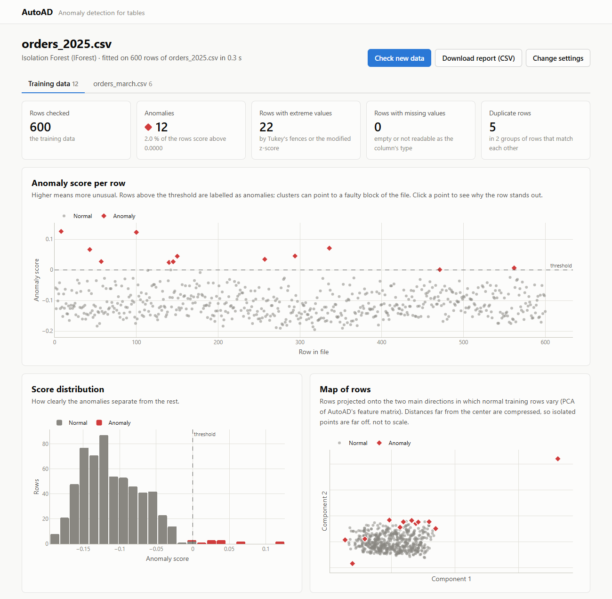
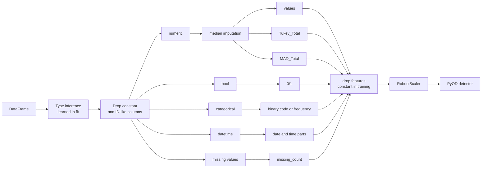

<a href="docs/img/webui_results.png"></a>

# AutoAD

**Anomaly detection for mixed-type tables, without the preprocessing work.**

[](https://github.com/JAdelhelm/AutoAD/actions/workflows/ci.yml)

[](LICENSE)


AutoAD turns a pandas DataFrame with numbers, text, booleans and dates into a numeric
feature matrix and fits any [PyOD](https://github.com/yzhao062/pyod) detector on it.
The report then tells you which rows are unusual, and why.

- **One call instead of a pipeline.** Types are learned per column, and new data is
  cast, encoded and scaled exactly like the training data.
- **Scores you can explain.** Every row lists its extreme values (Tukey's fences and the
  modified z-score), its missing values and its categories that are new.
- **Nothing hidden.** Dropped columns, learned types and removed features are stored on
  the fitted object.
- **A scikit-learn estimator.** `fit`, `transform`, `predict`, `get_params` and `clone`
  work as usual.
- **Also in the browser.** A local [web interface](#web-interface) covers the same steps
  without Python.

<br clear="both">

[Quick start](#quick-start) · [Installation](#installation) · [Web interface](#web-interface) · [Output](#output) · [Parameters](#parameters) · [How it works](#how-it-works) · [Limitations](#limitations)

> **Status:** 0.x, the API may still change. See the [changelog](CHANGELOG.md).

## Quick start

The bundled example files contain the same ten employees twice. In `X_test.csv` two
salaries are wrong and three ages are missing.

```python
import pandas as pd
from pyod.models.lof import LOF

from autoad import AutoAD

X_train = pd.read_csv("examples/X_train.csv")  # known-good data
X_test = pd.read_csv("examples/X_test.csv")    # new data to check

ad = AutoAD(detector=LOF(n_neighbors=3)).fit(X_train)

report = ad.report(X_test)                     # X_test plus anomaly information
columns = ["Name", "Salary", "AD_score", "MAD_Columns", "Missing_Columns", "Unseen_Columns"]
top = report.sort_values("AD_score", ascending=False)[columns].head(4)
print(top.round(2).to_string(index=False))
```

```text
 Name     Salary  AD_score MAD_Columns Missing_Columns Unseen_Columns
Diana 8000000.00    129.16      Salary             Age
 Zara  900000.00     13.46      Salary                           Name
 Hank   47000.75      1.26
Grace   65000.25      1.01                         Age
```

Both wrong salaries end up on top, and the `*_Columns` say what is unusual about a row.
The other methods:

```python
scores = ad.decision_function(X_test)  # higher = more anomalous
labels = ad.predict(X_test)            # 0/1, based on the detector's contamination
features = ad.transform(X_test)        # the scaled matrix the detector sees
findings = ad.findings(X_test)         # the findings per cell, as boolean DataFrames
duplicates = ad.duplicates(X_test)     # rows that duplicate another row
```

Any PyOD detector works. With only ten training rows the example uses LOF with 3
neighbours; on real data `IForest` is a good start.
[`examples/main.py`](examples/main.py) is this example as a script, and
[`examples/examples.ipynb`](examples/examples.ipynb) walks through twelve typical tasks
on synthetic data (`pip install -e ".[examples]"`).

## Installation

```bash
pip install "git+https://github.com/JAdelhelm/AutoAD.git"
```

For development:

```bash
git clone https://github.com/JAdelhelm/AutoAD.git
cd AutoAD
pip install -e ".[dev]"
pytest
```

Python 3.11 or newer is required. The distribution name is `autoad-framework` and the
import name is `autoad`. The name `autoad` on PyPI belongs to an unrelated project that
uses the same import name, so do not install both in one environment.

## Web interface

[`webui/`](webui/README.md) is a small Django app for working in the browser instead of
in Python (screenshot at the top):

1. Upload a CSV, Excel, JSON or Parquet file.
2. Check how AutoAD reads the columns and choose a detector.
3. Explore the result: the anomaly score per row, the score distribution, a map of the
   rows, the findings per column, groups of duplicate rows and the table of rows with
   the unusual cells marked. A page per row explains its score.
4. Check new files against the same model.

```bash
pip install -e . -r webui/requirements.txt
python webui/manage.py migrate
python webui/manage.py runserver   # then open http://127.0.0.1:8090
```

It is a local tool without user accounts. Do not run it on a public server. Parquet
files also need `pyarrow`.

## Output

### `report(X)`

A copy of `X` (rows in their original order) with these columns added:

| Column | Meaning |
| --- | --- |
| `AD_score` | Score of the detector, higher means more anomalous. Only if a detector was given. |
| `Tukey_Total` | Number of the row's numeric values outside Tukey's fences (`Q1 - 1.5·IQR`, `Q3 + 1.5·IQR`). |
| `MAD_Total` | Number of the row's numeric values with a modified z-score above 3.5. |
| `Tukey_Columns`, `MAD_Columns` | Names of those columns, comma separated. |
| `Missing_Columns` | Columns with a missing value in the row, including values that could not be read as the column's type. |
| `Unseen_Columns` | Categorical columns whose value did not occur in the training data. |

`findings(X)` returns the same findings per cell: a dict of boolean DataFrames
(`"Tukey"`, `"MAD"`, `"Missing"`, `"Unseen"`) with the index of `X` and one column per
input column the finding applies to. Use it instead of splitting the `*_Columns` strings.

### `duplicates(X, tolerance=0.0)`

Rows of `X` that duplicate another row of `X`. This is the anomaly logic turned around.
A KNN detector with 2 neighbours is fitted on the feature matrix of `X` and scores the
same rows. Every row is its own first neighbour, so the score is the distance to the
closest *other* row, and a low score marks a duplicate. The fitted detector is not
involved, and columns AutoAD does not use are not compared (ID-like, constant,
`exclude_columns`). So two orders that differ only in their order number are duplicates.

```python
dups = ad.duplicates(X)
dups[dups["is_duplicate"]].sort_values("Duplicate_group")
```

| Column | Meaning |
| --- | --- |
| `Duplicate_score` | Distance to the closest other row in the scaled feature space; 0 for identical rows. |
| `Closest_row` | Index label of that row. |
| `Differing_Columns` | Used columns in which the two rows differ; empty for identical rows. |
| `Duplicate_group` | Number of the group of rows that duplicate each other, `<NA>` for other rows. |
| `is_duplicate` | True for every row in a group. |

With `tolerance=0` only rows with identical values count. The values are compared as well
as the features, because different values can share a feature: two categories with the
same frequency, or a missing value and the median it is imputed with. A larger tolerance
also finds near duplicates within that distance. With the robust scaler, 0.05 allows one
number to differ by 5 % of its interquartile range. Lowest scores are not simply flagged
as duplicates (an inverted contamination), so a table without duplicates gets no flags.

### `transform(X)`

The scaled feature matrix. Features that are constant in the training data are left out
and listed in `dropped_features_`, for example `missing_count` if the training data has
no missing values, or `MAD_Total` if no training value is flagged. Feature names (see
`get_feature_names_out()`):

| Column type | Features |
| --- | --- |
| numeric | the value itself, plus `Tukey_Total` and `MAD_Total` for the row |
| bool | 0/1 |
| categorical, at most 20 distinct values | binary code `<name>_0`, `<name>_1`, ... ([BinaryEncoder](https://contrib.scikit-learn.org/category_encoders/binary.html)) |
| categorical, more distinct values | `<name>_FREQ`: share of the category in the training data, 0 for unseen categories |
| datetime | `<name>_YEAR`, `_MONTH`, `_DAY`, `_WKDAY`, plus `_HOUR`, `_MINUTE`, `_SECOND` if the column contains a time of day |
| all columns | `missing_count`: number of missing values in the row, counted before imputation (only if the training data has missing values, otherwise it is constant) |

### Attributes after `fit`

| Attribute | Content |
| --- | --- |
| `column_types_` | type learned for every column |
| `dropped_columns_` | dropped columns and the reason (`"constant"` or `"id"`) |
| `dropped_features_` | features removed because they are constant in the training data |
| `column_groups_` | columns per feature group |
| `known_categories_` | categories seen during `fit`, per categorical column |
| `feature_names_in_` | columns seen during `fit` |
| `feature_importances` | importance per feature, for detectors with `feature_importances_` such as `IForest` |
| `preprocessor_`, `detector_` | the fitted scikit-learn pipeline and detector |

## Parameters

| Parameter | Default | Description |
| --- | --- | --- |
| `detector` | `None` | Unfitted PyOD detector. Without one, AutoAD only builds the feature matrix. |
| `datetime_columns` | `None` | Columns to parse as dates. Other text columns become dates only if at least 95 % of their values are dates. |
| `numerical_columns` | `None` | Columns to treat as numbers although they are stored as text. |
| `exclude_columns` | `None` | Columns to ignore. They may be missing in later inputs. |
| `drop_constant` | `True` | Drop columns with a single distinct value (missing counts as a value), and features that are constant in the training data. Constant features carry no information and make some detectors fail (PyOD's PCA returns infinite scores). |
| `drop_id_columns` | `True` | Drop ID-like columns: unique, complete values with a name such as `id`/`customer_id`, or unnamed integer columns with consecutive values (from 20 rows on). |
| `max_binary_categories` | `20` | Categorical columns with more distinct values are frequency-encoded. |
| `tukey_factor` | `1.5` | IQR multiple for Tukey's fences. |
| `mad_threshold` | `3.5` | Threshold for the modified z-score. |
| `missing_indicator` | `"count"` | `"count"`: one `missing_count` column; `"columns"`: one `<name>_MISSING` column per input column; `None`: no marker. |
| `scaler` | `"robust"` | `"robust"`, `"standard"`, `"minmax"`, `None` (no scaling) or any scikit-learn transformer. |
| `n_jobs` | `1` | Parallel jobs for the column transformer. |

`AutoAD` is a scikit-learn estimator: `get_params`, `set_params` and `clone` work, and
`fit` returns the estimator itself.

## How it works



**Types** are learned once during `fit`. Text columns become numeric if all values are
numbers (`"2001"` stays a number), datetime only if at least 95 % of the values contain
digits and parse as dates, otherwise categorical. Placeholders such as `""`, `"nan"` or
`"None"` count as missing. During `transform` every column is cast to its learned type;
values that do not fit become missing.

**Tukey and MAD** are computed per column on the imputed training data. If the IQR of a
column is 0, Tukey falls back to the 5 %/95 % quantiles (and skips the column if those
are equal too). If the MAD is 0, the modified z-score uses the mean absolute deviation
(`M = (x - median) / (1.253314 · MeanAD)`).

**Binary encoding** of nominal columns needs far fewer dimensions than one-hot encoding
and performed comparably in these studies:

- John T. Hancock and Taghi M. Khoshgoftaar. "Survey on categorical data for neural
  networks." Journal of Big Data 7.1 (2020), pp. 1-41, tables 2 and 4.
- Diogo Seca and João Mendes-Moreira. "Benchmark of Encoders of Nominal Features for
  Regression." World Conference on Information Systems and Technologies, 2021,
  pp. 146-155, p. 151.

The original design diagram is in [`docs/img/decision_rules.png`](docs/img/decision_rules.png).
It shows the first concept; ordinal encoding and pattern recognition from that diagram
are not part of the current version.

## Limitations

- Tukey and MAD look at one numeric column at a time. Unusual combinations of normal
  values are left to the detector.
- The detector decides the quality of `AD_score`. The repository contains no benchmark,
  so compare detectors on your own data.
- Binary codes are not ordinal: the distance between two categories says nothing about
  their similarity.
- Rows are treated as independent. There is no sequence or time series model; dates are
  encoded as calendar parts.
- A time of day is only encoded if the column contained one during `fit`. Columns and
  features that are constant during `fit` are dropped, even if they vary later.
- ID detection is a heuristic. Check `dropped_columns_`, or set `drop_id_columns=False`.
- Missing values are imputed (median or most frequent value). Their signal reaches the
  detector only through `missing_count`, and only if the training data had missing
  values. Missing values that first appear in new data therefore do not change
  `AD_score`; `report()` lists them in `Missing_Columns`. Unseen categories still get a
  code of their own (a new binary code, or frequency 0) and are listed in `Unseen_Columns`.
- The same applies to `Tukey_Total` and `MAD_Total`: if no training value is flagged,
  they are constant and not used by the detector. The extreme values themselves still
  reach the detector, and `report()` still counts the findings.
- Very small training sets give unstable scores. For neighbour-based detectors such as
  LOF or KNN, `n_neighbors` must be smaller than the number of training rows.

<!--
### Reference
- https://www.researchgate.net/publication/379640146_Detektion_von_Anomalien_in_der_Datenqualitatskontrolle_mittels_unuberwachter_Ansatze (German Thesis)
-->

## License

MIT, see [LICENSE](LICENSE).
