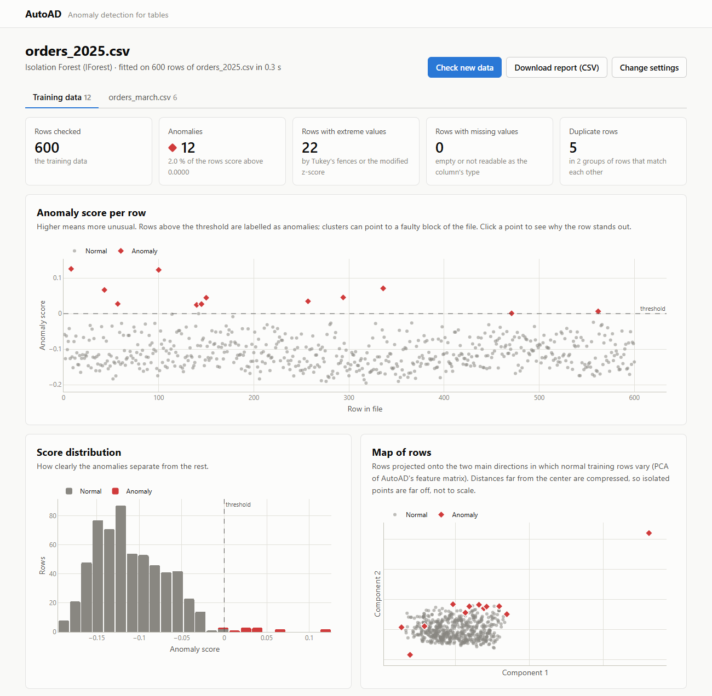

# AutoAD web interface

A Django app to run AutoAD on a file in the browser and inspect the anomalies. It is
meant for your own machine: there are no user accounts, so do not run it on a public
server.



## Start

From the repository root:

```bash
pip install -e . -r webui/requirements.txt
python webui/manage.py migrate
python webui/manage.py runserver
```

Open http://127.0.0.1:8090. To try it, upload `examples/X_train.csv` and later check
`examples/X_test.csv` against it.

`runserver` uses port 8090 here instead of Django's 8000, which editors such as Cursor
or VS Code often occupy. If 8090 is taken too (on Windows Django then says "You don't
have permission to access that port"), pass another port, e.g.
`python webui/manage.py runserver 9000`, or set `AUTOAD_WEB_PORT`.

## Workflow

1. **Upload** a CSV/TSV/TXT, Excel (`.xlsx`), JSON, JSON Lines or Parquet file. Parquet
   needs `pyarrow`. For text files the separator, decimal mark and encoding are detected.
   A semicolon file is read with a decimal comma (`3,5`), as exported by German Excel.
   You can set all three yourself under *File options*.
2. **Configure**: AutoAD shows the type it detected for each column. Set a column to
   *Number*, *Date* or *Ignore* if needed, choose the detector (Isolation Forest, ECOD,
   KNN, LOF or the ensemble of the first three) and the contamination, and adjust
   AutoAD's settings under *Advanced*.
3. **Results** of the training data:
   - figures: the number of anomalies, rows with extreme values and rows with missing
     values;
   - the anomaly score per row and the score distribution;
   - a map of the rows (PCA of AutoAD's feature matrix);
   - the findings per column and the feature importance (Isolation Forest only);
   - groups of duplicate rows (see below);
   - the table of rows, where extreme, missing and new values are marked. The filter
     *Duplicates, by group* puts the rows of each group next to each other.

   You can download the report as CSV, and the page shows the Python code that repeats
   the analysis with the library.
4. **Row page**: why a row stands out. Each value is shown with its findings and its
   position within the training data.
5. **Check new data** scores another file with the same model. It needs the same
   columns, in any order, and its results get their own tab.

## Duplicates

Every checked table is also searched for rows that duplicate each other, with
`AutoAD.duplicates()`. A KNN with 2 neighbours gives every row the distance to its closest
other row (the row itself is its first neighbour). A low score marks a duplicate, the
reverse of the anomaly score. ID-like, constant and ignored columns are not compared.
The tolerance on the configure page decides what counts as a duplicate:

- 0 (default): only rows with identical values.
- larger values: also near duplicates. The results show the columns in which they differ.

## Settings

Everything is configured through environment variables (see `autoad_web/settings.py`):

| Variable | Default | Meaning |
| --- | --- | --- |
| `AUTOAD_WEB_PORT` | `8090` | Default port of `manage.py runserver` |
| `AUTOAD_WEB_DATA_DIR` | `webui/data` | Database, uploads, fitted models and results |
| `AUTOAD_WEB_MAX_UPLOAD_MB` | `100` | Largest accepted file |
| `AUTOAD_WEB_MAX_TRAIN_ROWS` | `50000` | Larger files are fitted on a random sample of this many rows; all rows are scored |
| `AUTOAD_WEB_MAX_PLOT_POINTS` | `20000` | Most points per chart; anomalies are always shown |
| `AUTOAD_WEB_TIME_ZONE` | `UTC` | Time zone for displayed dates |
| `AUTOAD_WEB_DEBUG` | `1` | With `0`, static files must be served by a web server (`collectstatic`) |
| `AUTOAD_WEB_SECRET_KEY` | generated | Stored in the data directory if not set |
| `AUTOAD_WEB_ALLOWED_HOSTS` | `127.0.0.1,localhost` | Comma separated |

The detector runs inside the request, so large files with KNN or LOF can take a while.
The charts use `plotly.min.js` from the installed `plotly` package and need no internet
connection.

## Development

```bash
python webui/manage.py test detection
```

The code that does the work is in `detection/services/`: reading files (`readers.py`),
running AutoAD and storing results (`runner.py`), and preparing charts (`charts.py`),
tables (`tables.py`) and the Python code (`code.py`). Views and templates only display
these results.
